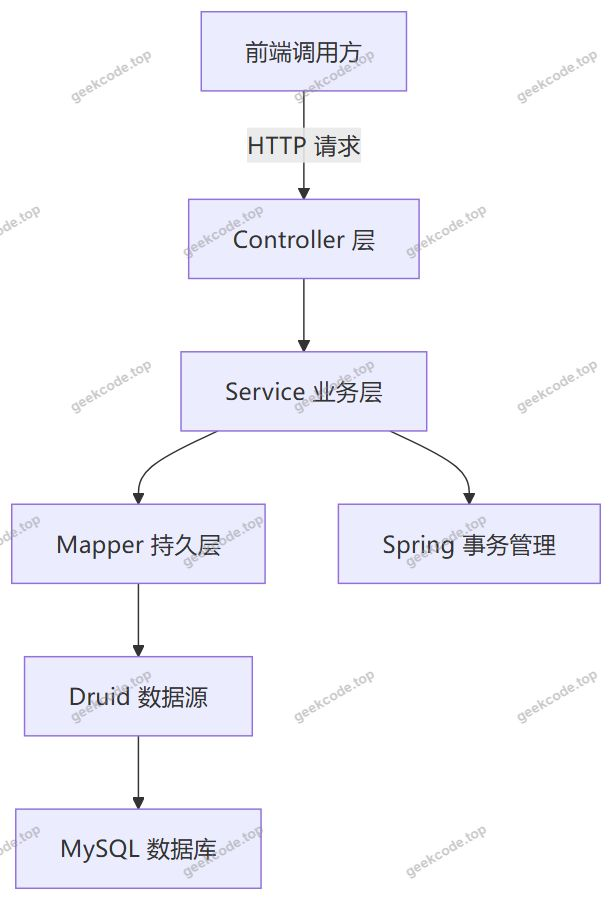
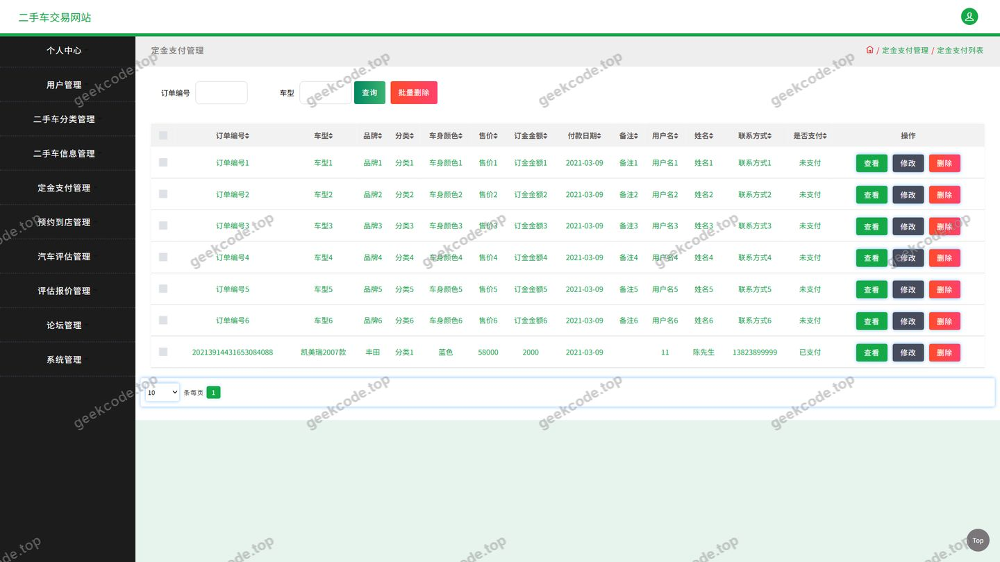
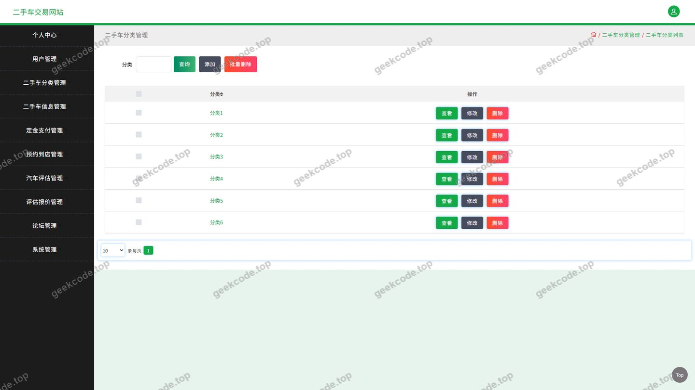
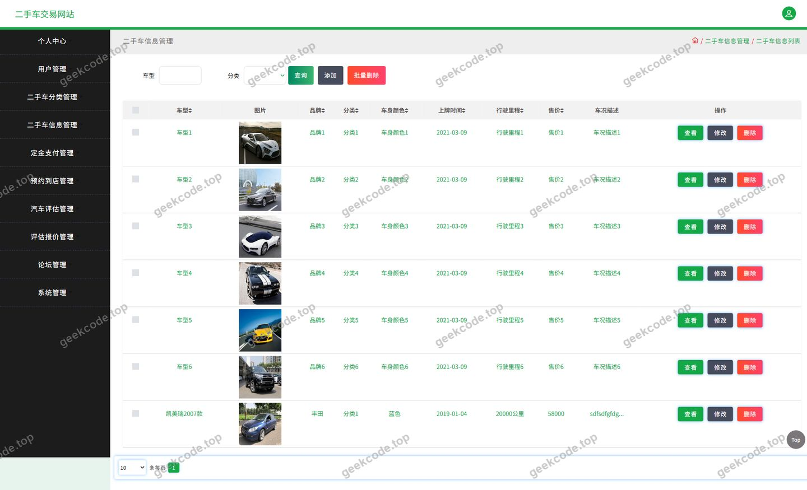
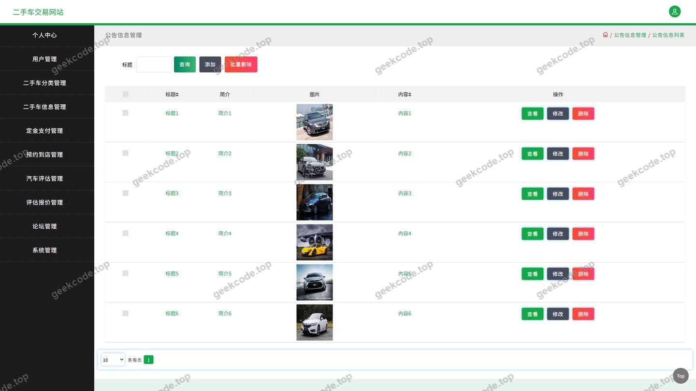
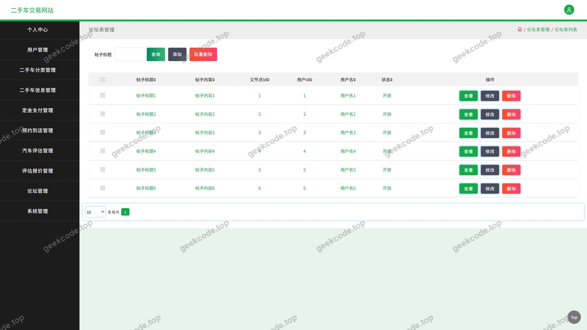
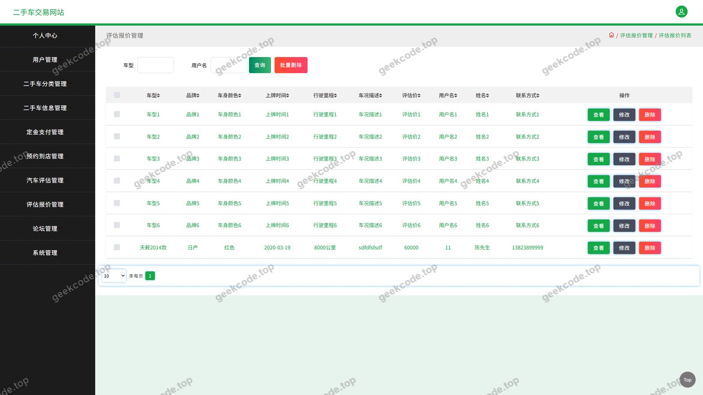
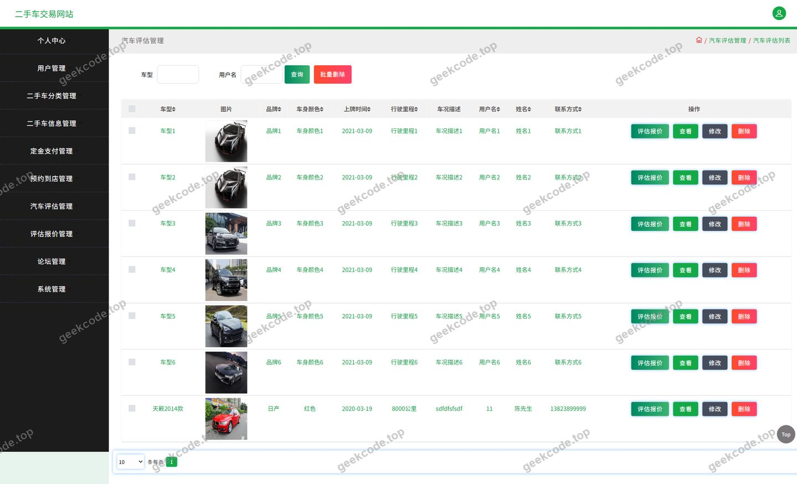
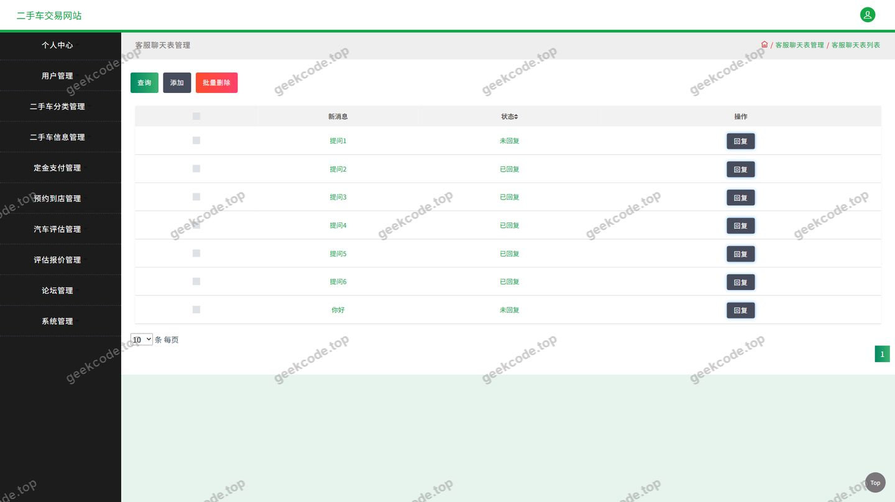

# ssm二手车交易网站-计算机java毕业设计

> 🎓 **计算机毕业设计 · ssm二手车交易网站-计算机java毕业设计**
>
> 本仓库只放**项目介绍 + 运行截图**（截图是站点带水印的原图，存在仓库 `images/` 里）。
>
> 👉 **完整可运行源码 / 数据库脚本 / 部署文档：[点我获取](https://geekcode.top/archives/ssm%E4%BA%8C%E6%89%8B%E8%BD%A6%E4%BA%A4%E6%98%93%E7%BD%91%E7%AB%99-%E8%AE%A1%E7%AE%97%E6%9C%BAjava%E6%AF%95%E4%B8%9A%E8%AE%BE%E8%AE%A1?utm_source=github)**
>
> 💬 咨询微信：**ir9372**　|　🌐 更多项目：[极客代码 geekcode.top](https://geekcode.top/?utm_source=github)
>
> 📌 项目详情页：<https://geekcode.top/archives/ssm%E4%BA%8C%E6%89%8B%E8%BD%A6%E4%BA%A4%E6%98%93%E7%BD%91%E7%AB%99-%E8%AE%A1%E7%AE%97%E6%9C%BAjava%E6%AF%95%E4%B8%9A%E8%AE%BE%E8%AE%A1?utm_source=github>

<table><td width="230" align="center"> <b>扫码加微信 ir9372</b></td><td valign="middle">📦 源码 = 项目介绍 + 全部运行截图 + 数据库 + 部署文档 👉 点上方任意截图，直接跳到 <b>极客代码 geekcode.top</b> 详情页</td></table>

---

<h1>ssm二手车交易网站-计算机java毕业设计</h1>
<h2>项目概述</h2>

本项目为二手车交易网站的后端服务工程，采用纯 API 形式对外提供数据接口，不内嵌前端页面代码，页面由配套的前端工程调用本服务接口完成渲染。系统围绕二手车交易的完整业务链路进行设计，涵盖二手车分类、二手车信息发布与浏览、汽车评估、评估报价、定金支付、论坛交流、新闻资讯与公告、收藏与个人中心等核心业务场景。用户可通过前端应用浏览车源信息、发布待售车辆、查看汽车评估结果与报价、支付定金、收藏意向车辆，并在论坛中与其他用户交流；管理侧则通过用户管理与各业务数据维护接口完成平台内容治理。项目适用于二手车交易平台类课程设计与毕业设计场景，适合作为计算机专业学生在 Java Web 后端方向进行需求分析、数据库设计与分层架构实践的完整案例。技术架构上，工程基于经典 Spring 分层体系构建，持久层采用 MyBatis-Plus，数据源由 Druid 连接池管理，对外统一以 HTTP 接口形式暴露服务。

<h2>技术架构</h2>
<h3>整体架构</h3>

本工程为纯后端 API 工程，采用前后端分离的调用模式：前端工程通过 HTTP 请求调用本服务的 Controller 接口，接口以结构化数据格式返回业务结果。工程内部遵循经典三层结构，由 Controller 层接收请求并做参数校验与结果封装，Service 业务层承载业务逻辑与事务控制，Mapper 持久层基于 MyBatis-Plus 完成数据库访问。

<h3>技术选型</h3>
<table>
<thead>
<tr>
<th>层次</th>
<th>技术组件</th>
<th>说明</th>
</tr>
</thead>
<tbody><tr>
<td>核心容器</td>
<td>spring-core、spring-beans、spring-context、spring-context-support</td>
<td>提供 IoC 容器与上下文支持</td>
</tr>
<tr>
<td>切面与事务</td>
<td>spring-aop、spring-tx</td>
<td>提供面向切面编程能力与声明式事务管理</td>
</tr>
<tr>
<td>Web 层</td>
<td>spring-web、spring-webmvc</td>
<td>提供 MVC 请求分发与参数绑定能力</td>
</tr>
<tr>
<td>数据访问</td>
<td>spring-jdbc、MyBatis-Plus</td>
<td>提供 JDBC 基础能力与增强型 ORM 映射</td>
</tr>
<tr>
<td>连接池</td>
<td>Druid</td>
<td>统一管理数据库物理连接</td>
</tr>
<tr>
<td>测试</td>
<td>junit</td>
<td>支撑单元测试</td>
</tr>
</tbody></table>
<h3>选型理由</h3>

MyBatis-Plus 在 MyBatis 基础上提供了通用 CRUD 与条件构造能力，对于二手车信息、分类、新闻、论坛等以数据管理为主的业务实体，可显著减少重复的 SQL 编写工作量；Druid 作为成熟的数据库连接池组件，可对连接资源进行统一管理与复用，提升数据库访问的稳定性；Spring 生态各模块相互配合，使事务管理、依赖注入与 MVC 请求处理形成完整闭环，符合分层架构的职责划分原则。

<h3>数据库设计要点</h3>

数据库采用关系型数据库 MySQL 存储业务数据。根据现有接口结构，数据实体围绕用户、二手车信息、二手车分类三条主线展开，并在此基础上延伸出论坛、新闻资讯、公告、收藏、定金支付、汽车评估、评估报价、聊天消息、系统配置与文件等业务数据。二手车信息与二手车分类之间、收藏与用户及二手车信息之间、评估报价与汽车评估之间应存在业务关联关系。除上述实体范围外，根据现有信息无法确定具体的表名、字段清单、索引设计及外键约束细节。

<h2>功能模块</h2>

项目自身不包含前台与后台的路由配置，全部功能以接口形式提供。为便于说明，按业务服务对象划分为用户端功能与管理端功能两部分。

<h3>用户端功能</h3>
<table>
<thead>
<tr>
<th>模块</th>
<th>对应控制器</th>
<th>功能描述</th>
</tr>
</thead>
<tbody><tr>
<td>登录与用户</td>
<td>用户相关接口</td>
<td>提供用户登录与用户信息处理能力，对应登录页面与用户页面</td>
</tr>
<tr>
<td>二手车分类</td>
<td>ErshouchefenleiController</td>
<td>提供二手车分类数据的查询与维护接口，支撑分类导航与筛选</td>
</tr>
<tr>
<td>二手车信息</td>
<td>ErshouchexinxiController</td>
<td>提供二手车信息的发布、查询、详情浏览与维护接口，是平台的核心业务模块</td>
</tr>
<tr>
<td>论坛信息</td>
<td>ForumController</td>
<td>提供论坛帖子的发布、查询与互动接口，支撑用户之间的交流</td>
</tr>
<tr>
<td>新闻资讯与公告</td>
<td>NewsController</td>
<td>提供新闻资讯、公告信息的内容查询与展示接口</td>
</tr>
<tr>
<td>收藏管理</td>
<td>StoreupController</td>
<td>提供收藏记录的添加、取消与查询接口，支撑&quot;我的收藏&quot;功能</td>
</tr>
<tr>
<td>定金支付</td>
<td>DingjinzhifuController</td>
<td>提供定金支付相关业务接口，完成购车定金环节的数据处理</td>
</tr>
<tr>
<td>汽车评估</td>
<td>QichepingguController</td>
<td>提供汽车评估信息的提交与查询接口</td>
</tr>
<tr>
<td>评估报价</td>
<td>PinggubaojiaController</td>
<td>提供评估报价结果的生成与查询接口，与汽车评估模块配合使用</td>
</tr>
<tr>
<td>在线聊天</td>
<td>ChatController</td>
<td>提供用户之间的消息交互接口，支撑在线沟通与咨询</td>
</tr>
<tr>
<td>文件服务</td>
<td>FileController</td>
<td>提供文件上传与下载接口，为车辆图片、附件等资源提供存储访问能力</td>
</tr>
<tr>
<td>通用接口</td>
<td>CommonController</td>
<td>提供公共基础能力接口；根据现有信息无法确定其具体职责范围</td>
</tr>
<tr>
<td>系统配置</td>
<td>ConfigController</td>
<td>提供系统配置项的读取与维护接口</td>
</tr>
</tbody></table>
<h3>管理端功能</h3>

管理端以前端管理页面调用后端接口的方式实现，主要包含以下功能模块：

<ul>
<li>用户管理：对平台注册用户信息进行查询与维护，对应截图中的用户页面。</li>
<li>二手车分类管理：维护二手车分类数据，为前台分类展示提供数据来源。</li>
<li>二手车信息管理：对用户发布的二手车信息进行审核、修改与下架处理。</li>
<li>论坛管理：对论坛帖子进行查询与违规内容处理。</li>
<li>新闻资讯与公告管理：维护新闻资讯与公告信息内容。</li>
<li>汽车评估与评估报价管理：查看与管理用户提交的评估信息及对应的报价数据。</li>
<li>定金支付管理：查询定金支付业务记录，掌握交易进展。</li>
<li>系统配置管理：维护平台运行所需的配置项。</li>
</ul>
<h2>用户角色与权限</h2>

根据现有信息，系统中涉及的角色分为普通用户与管理员两类。

<h3>普通用户</h3>

普通用户通过登录接口完成身份认证后，可访问以下功能模块：

<ul>
<li>个人中心：查看与维护个人基本信息。</li>
<li>我的发布：查看与管理本人发布的二手车信息，对应前台导航中的&quot;二手车信息&quot;发布能力。</li>
<li>我的收藏：通过收藏接口管理已收藏的二手车信息，对应个人中心菜单中的&quot;我的收藏&quot;。</li>
<li>二手车信息浏览：查询二手车列表与详情，按分类进行筛选浏览。</li>
<li>二手车分类浏览：查看平台提供的二手车分类数据。</li>
<li>论坛信息：浏览论坛帖子并参与发帖与交流。</li>
<li>新闻资讯：浏览平台发布的新闻资讯与公告信息。</li>
<li>定金支付：对意向车辆提交定金支付操作。</li>
<li>汽车评估：提交车辆评估信息并查看评估结果。</li>
<li>评估报价：查看由评估结果生成的报价信息。</li>
<li>在线聊天：与其他用户进行消息沟通。</li>
</ul>
<h3>管理员</h3>

管理员负责平台的数据治理与内容维护，可访问以下功能模块：

<ul>
<li>用户管理：查询与维护平台用户信息，对应截图中的用户页面。</li>
<li>二手车分类管理：新增、修改与删除二手车分类数据。</li>
<li>二手车信息管理：对平台内的二手车信息进行查询、编辑与下架处理。</li>
<li>论坛管理：查询与管理论坛帖子内容。</li>
<li>新闻资讯与公告管理：发布与维护新闻资讯、公告信息。</li>
<li>汽车评估与评估报价管理：查看用户提交的评估数据与生成的报价数据。</li>
<li>定金支付管理：查看平台内的定金支付记录。</li>
<li>系统配置管理：维护系统运行所需的配置参数。</li>
</ul>

需要指出的是，本工程未提供后台路由配置，上述管理功能均通过后端接口形式对外提供，由外部管理端页面进行调用。根据现有信息无法确定系统是否还存在其他角色类型。

<h2>项目特色与创新点</h2>
<ol>
<li>
业务链路完整。系统覆盖了二手车交易从&quot;分类浏览 → 信息发布 → 汽车评估 → 评估报价 → 定金支付 → 收藏留存 → 论坛交流&quot;的完整链路，各环节均有独立的接口模块支撑，业务闭环程度较高，区别于功能单一的车辆信息展示类系统。

</li>
<li>
引入汽车评估与评估报价联动机制。系统将汽车评估与评估报价拆分为两个相互配合的模块，用户提交车辆评估信息后可获取对应的报价结果，为二手车定价提供了数据化的参考依据，提升了平台的专业性。

</li>
<li>
定金支付环节的设计。系统将定金支付独立成模块，对应交易过程中的意向确认环节，使线上交易流程更贴近二手车交易的真实业务场景。

</li>
<li>
社区化交流能力。通过论坛与在线聊天模块，平台在交易功能之外补充了用户沟通渠道，用户可以围绕车源信息进行咨询与讨论，增强了平台的互动属性。

</li>
<li>
前后端解耦的纯 API 架构。工程不内嵌页面代码，所有能力以接口形式对外提供，接口可同时服务于网页端、移动端等多种前端形态，便于前端工程的独立迭代与后续维护。

</li>
<li>
采用 MyBatis-Plus 与 Druid 的组合。MyBatis-Plus 承担持久层映射与通用数据访问职责，Druid 负责数据库连接的统一管理，二者结合在保证数据访问效率的同时降低了重复编码成本。

</li>
</ol>
<h2>部署环境</h2>
<table>
<thead>
<tr>
<th>环境项</th>
<th>要求说明</th>
</tr>
</thead>
<tbody><tr>
<td>JDK</td>
<td>需安装 JDK 并配置 JAVA_HOME；根据现有信息未明确具体版本号，需与所选 Spring 版本保持一致</td>
</tr>
<tr>
<td>数据库</td>
<td>MySQL，需提前创建数据库并导入初始化数据脚本</td>
</tr>
<tr>
<td>连接池</td>
<td>Druid，通过工程配置文件中的数据源参数连接 MySQL</td>
</tr>
<tr>
<td>构建工具</td>
<td>Maven，用于依赖管理与工程打包</td>
</tr>
<tr>
<td>Web 容器</td>
<td>由于工程包含 spring-web 与 spring-webmvc 模块，需部署于支持 Servlet 规范的 Web 容器中运行</td>
</tr>
<tr>
<td>单元测试</td>
<td>JUnit，用于执行工程内的测试用例</td>
</tr>
<tr>
<td>前端环境</td>
<td>本工程为纯 API 后端工程，不包含前端页面代码，因此无需安装 Node.js；如配套前端为小程序形态，则需使用对应的开发者工具进行调试</td>
</tr>
</tbody></table>

部署时需先完成数据库的创建与初始化，再根据实际环境修改数据源连接参数，随后通过构建工具打包并将产物部署至 Web 容器启动运行。启动后前端应用即可通过接口地址访问本服务。

<h2>五、技术特性</h2>
<ul>
<li>使用 MyBatis-Plus 简化数据访问层开发</li>
</ul>
<h2>六、功能模块截图</h2>
<h3>后台管理端</h3>
<h4>页面-登录</h4>

<h4>页面-定金支付</h4>

<h4>页面-二手车分类</h4>

<h4>页面-二手车信息</h4>

<h4>页面-公告信息</h4>

<h4>页面-论坛</h4>

<h4>页面-评估报价</h4>

<h4>页面-汽车评估</h4>

<h4>页面-用户</h4>

---

## 获取完整源码

| 项目 | 说明 |
| --- | --- |
| 项目名 | ssm二手车交易网站-计算机java毕业设计 |
| 运行截图 | 本文 10 张（站点带水印原图，仓库 `images/` 目录） |
| 完整源码 | [https://geekcode.top/archives/ssm%E4%BA%8C%E6%89%8B%E8%BD%A6%E4%BA%A4%E6%98%93%E7%BD%91%E7%AB%99-%E8%AE%A1%E7%AE%97%E6%9C%BAjava%E6%AF%95%E4%B8%9A%E8%AE%BE%E8%AE%A1?utm_source=github](https://geekcode.top/archives/ssm%E4%BA%8C%E6%89%8B%E8%BD%A6%E4%BA%A4%E6%98%93%E7%BD%91%E7%AB%99-%E8%AE%A1%E7%AE%97%E6%9C%BAjava%E6%AF%95%E4%B8%9A%E8%AE%BE%E8%AE%A1?utm_source=github) |
| 咨询微信 | **ir9372**（备注：jingpin-yuanma） |
| 更多项目 | [极客代码 geekcode.top](https://geekcode.top/?utm_source=github) |

> 需要源码、部署、改配置、跑不起来等问题，加微信 ir9372 沟通，说明项目名即可。
